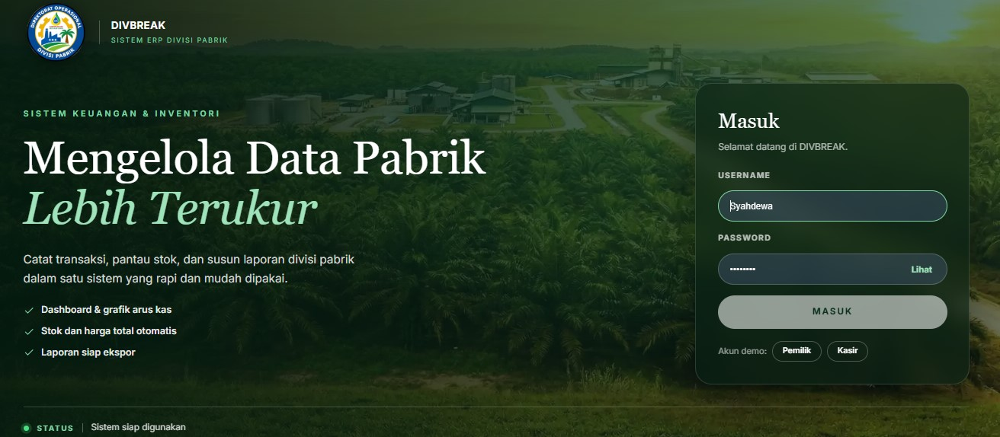
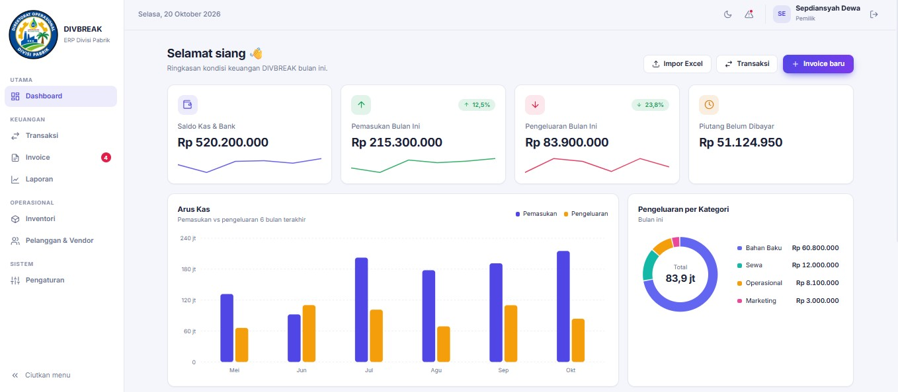
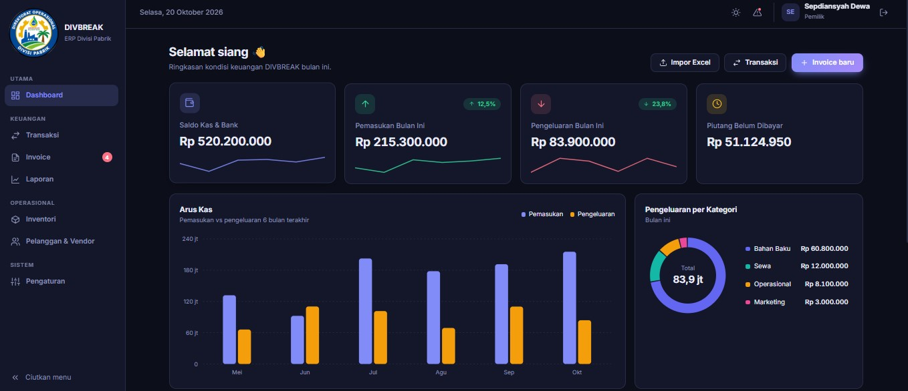
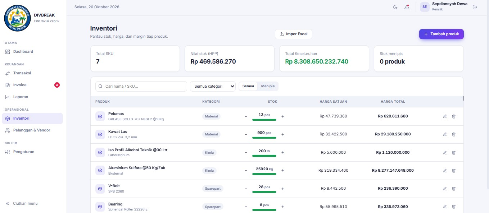
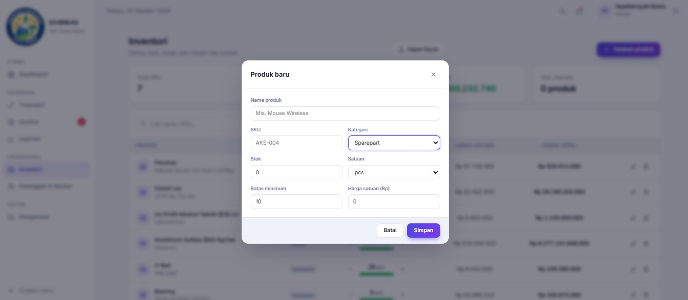

# DIVBREAK — ERP Keuangan & Inventori Pabrik

Aplikasi web untuk mencatat transaksi, memantau stok, mengelola invoice, dan menyusun laporan keuangan divisi pabrik dalam satu sistem yang rapi dan mudah dipakai.

**🔗 Demo:** https://sepdiansyahdewa.github.io/erp-divisi-pabrik/

## Tampilan

### Halaman login


### Dashboard



### Inventori



## Fitur

- **Dashboard** — ringkasan pemasukan, pengeluaran, dan grafik arus kas
- **Transaksi** — pencatatan pemasukan dan pengeluaran
- **Inventori** — stok produk dengan kategori, satuan, harga satuan, dan harga total otomatis (stok × harga satuan), serta penanda stok menipis
- **Invoice & Kontak** — kelola pelanggan/pemasok dan status tagihan
- **Laporan** — rekap keuangan siap ekspor
- **Impor data** — unggah data dari file Excel/CSV
- **Mode terang dan gelap**
- **Login berbasis peran** — hak akses berbeda untuk Pemilik dan Kasir

## Teknologi

- [Vue 3](https://vuejs.org/) (Composition API, `<script setup>`)
- [Vite](https://vitejs.dev/)
- Penyimpanan data di browser (localStorage)
- Deploy otomatis ke GitHub Pages dengan GitHub Actions

## Menjalankan di komputer lokal

```bash
git clone https://github.com/sepdiansyahdewa/erp-divisi-pabrik.git
cd erp-divisi-pabrik
npm install
npm run dev
```

Buka `http://localhost:5173/erp-divisi-pabrik/` di browser.

## Build untuk produksi

```bash
npm run build
```

Hasilnya ada di folder `dist/`.

## Catatan

Data disimpan di browser masing-masing pengguna. Login pada versi ini hanya untuk demonstrasi, bukan sistem keamanan produksi.

## Pembuat

**Sepdiansyah Dewa** — [GitHub](https://github.com/sepdiansyahdewa)
